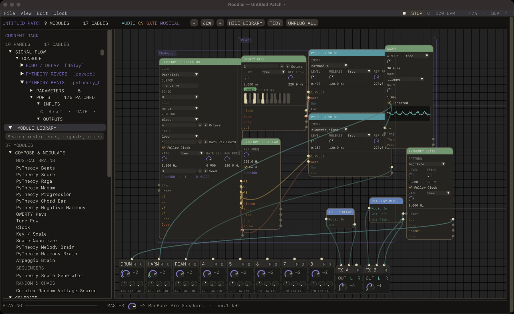

# Noodler

> *A modular music environment where theory itself is patchable.*



Noodler is a modular instrument in the spirit of Eurorack, written in Python
so [PyTheory](https://github.com/kennethreitz/pytheory) can live in the rack.
Scales, chords, guitar tunings and rhythms travel down cables the way voltage
does. It is not a DAW with cables drawn on it, and not Eurorack behind glass.

## Quickstart

macOS, Python 3.14, managed with [`uv`](https://docs.astral.sh/uv/):

```console
uv python install 3.14
uv sync
uv run noodler                              # a fresh rack
uv run noodler examples/dadgad-chapel.noodler
uv run noodler render examples/dadgad-chapel.noodler -o chapel.wav
uv run noodler midi examples/open-g-hymn.noodler -o hymn.mid
```

Press **▶ PLAY** (or tap space) and the rack starts. Nothing sounds until you
do. **File → Open Example** has the rest of the patches. **File → Export
Audio** bounces one to a WAV.

`render` and `midi` never open a window. `check` tells you whether a document
loads, and `modules` lists what you can patch.

## Two patches

**DADGAD Chapel** is a phrase in D major, played by a kalimba, over the open
strings of DADGAD strummed on a guitar. The numbers in the sequencer are
degrees of the Key beside it. A dot is a rest. The same notes leave through
MIDI Out.

**Open G, Capo 2** is the other one. `Fretboard.guitar("open g", capo=2)` is
an A major chord — E A E A C# E — and the patch strums it while an arpeggio
walks an A. The same document is `examples/open-g-hymn.toml`, which is the
patch as TOML if you would rather edit it as text.

A patch in Python is the same idea:

```python
from noodler.studio import Patch

patch = Patch("DADGAD Chapel").at(bpm=72)
patch.module("board", "fretboard", tuning="dadgad")
patch.module("voice", "pytheory_voice", instrument="acoustic_guitar")
patch.cable("board.pitch", "voice.pitch")
patch.cable("board.gate", "voice.gate")
patch.hear("voice.audio")
patch.save("chapel.noodler")          # or chapel.toml
```

`.noodler` files are JSON. `.toml` is the same document. Both open in the rack.

## What's inside

Sources, a clock, filters, envelopes, a mixer and a room. And the theory,
which is the point:

| | |
| --- | --- |
| Key / Scale, Quantizer | A scale down a cable, and a module that snaps any voltage into it. |
| Chord, Arpeggio | A chord by name, four voices, and a pattern that walks them. |
| Sequencer | A phrase written as degrees: `0 2 4 3  4 . 0 .` |
| Fretboard | `Fretboard.guitar(tuning, capo=)`, and a chord's ranked voicings. The first plays; the voicing control picks another. |
| MIDI Out | Pitch and gate in, a `.mid` file out. |

Around those: melody, harmony and arpeggio brains, an LFO, PyTheory's own
instruments, beats, scores, ragas, maqamat, tone rows, negative harmony, and
the rooms and effects from the library. The full shelf is in
[DOCS/MODULES.md](DOCS/MODULES.md).

Cables hang. Feedback is a one-block delay, on purpose. Groups move together.
Undo covers patching and knob sweeps.

## Rack controls

| Gesture or key | Action |
| --- | --- |
| Background drag or scroll | Pan · Space + drag pans from over a module |
| Pinch or − / 100% / + | Zoom · **F** frames the whole rack |
| Space tap or ⌘↩ | Play / stop |
| Shift + background drag | Box-select · Escape clears |
| ⌘G / ⌘⇧G | Group the selection / ungroup |
| Module title drag / double-click / right-click | Move · fold · collapse, duplicate, reset, unplug, remove |
| Knob drag, scroll, Shift, double-click | Turn · turn without panning · fine · reset |
| Click / double-click a cable | Pick it (Delete removes) / unpatch it |
| ⌘K · ⌘Z · ⌘⇧Z · T · L | Search the library · undo · redo · tidy · hide the library |

## Development

```console
uv sync
uv run ruff check
uv run pytest
```

Noodler is one Python application. Dear PyGui draws the rack, the engine owns
the graph, PyTheory supplies the musical primitives, and sounddevice feeds
Core Audio. `render` is the path that does not need a screen.

- [Architecture](DOCS/ARCHITECTURE.md) · [Technology](DOCS/TECHNOLOGY.md) ·
  [Modules](DOCS/MODULES.md) · [Audio](DOCS/AUDIO.md)
- [Interaction](DOCS/INTERACTION.md) · [Motion](DOCS/MOTION.md) ·
  [Editing and undo](DOCS/EDITING.md) · [Patch format](DOCS/PATCH_FORMAT.md)
- [Examples](examples/)

*Not a DAW with cables. Not Eurorack trapped on a screen. A place where sound,
voltage, chance, and musical thought can touch.*
